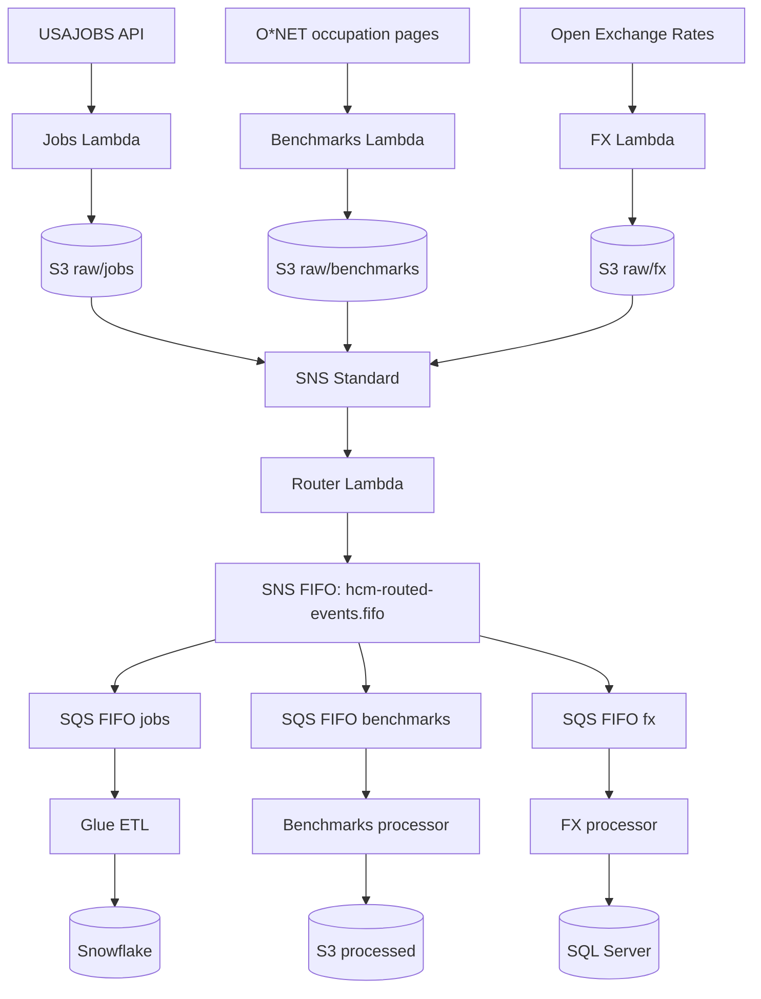

# Polarapt HCM — Real-Time Data Platform

**Data Engineering Hackathon | AWS | Python | SNS/SQS FIFO | Glue | Snowflake | SQL Server**

An event-driven HR data platform for job postings, occupational pay benchmarks, and foreign exchange rates. Built around the hackathon brief by Ayan Hussain (24 October 2026).

> **Project status (25 October 2026):** The three ingestion Lambdas were manually tested successfully on AWS. SNS Standard topic and its S3 publish access policy have been created. **S3 event notification, router Lambda, SNS FIFO, SQS FIFO, processors, Glue, destinations, and schedules are not yet deployed or verified.** Their reference implementations and setup notes are provided for subsequent work.

## Architecture



**Diagram shows target architecture, not all deployed resources.**

## Verified milestones

| Component | Evidence from manual AWS test | Status |
|---|---|---|
| USAJOBS Lambda | 500 jobs written to `raw/jobs/2026/10/24/2225.json` | Verified |
| O*NET benchmarks Lambda | 10 selected occupations written to `raw/benchmarks/2026/10/24/2318.json` | Verified |
| FX Lambda | 6 currencies written to `raw/fx/2026/10/24/2330.json` | Verified |
| SNS Standard topic | `hackathon-s3-events-owais` created and S3 publish policy saved | Configured, not end-to-end tested |
| S3 event notification | Not configured | Pending |
| SNS router / SNS FIFO / SQS FIFO | Reference code only | Pending |
| Benchmarks processor / FX processor / Glue | Reference code only | Pending |
| Snowflake / SQL Server load | Schemas and sample integration code only | Pending |
| EventBridge scheduling | Not enabled | Pending |

## Data sources and caveats

- **USAJOBS:** `https://data.usajobs.gov/api/search`, authenticated using registered email and API key; up to 500 records per request.
- **Salary benchmarks:** Original assignment specifies scraping the BLS highest-paying top-10 table. BLS returned HTTP 403/503 from AWS CloudShell, so the **working ingestion uses O*NET Online median wages for 10 manually selected occupations**. This is **not** a verified national top-10 ranking. Salary year observed: 2025. Do not present this alternative as identical to the assignment requirement.
- **FX:** Open Exchange Rates latest USD-base rates for PKR, SAR, AED, GBP, EUR, INR. Free-tier quota and rate refresh cadence can make minute-level polling inappropriate. The included schedule example is **disabled by default**.

## Repository layout

```text
polarapt-hcm-real-time-data-platform/
├── README.md
├── .env.example
├── .gitignore
├── requirements-dev.txt
├── ingestion/
│   ├── jobs/lambda_function.py
│   ├── benchmarks/lambda_function.py
│   ├── benchmarks/requirements.txt
│   └── fx/lambda_function.py
├── routing/
│   └── router_lambda/lambda_function.py
├── processing/
│   ├── benchmarks/lambda_function.py
│   ├── fx/lambda_function.py
│   ├── fx/requirements.txt
│   └── jobs_glue/glue_job.py
├── sql/
│   ├── sqlserver_schema.sql
│   └── snowflake_schema.sql
├── infrastructure/
│   ├── sns-topic-policy.json
│   ├── iam-policies/
│   ├── sqs-filter-policies/
│   └── eventbridge-schedule-example.json
├── scripts/
│   ├── package_benchmarks.sh
│   ├── verify_s3.sh
│   └── publish_github.sh
├── tests/
│   └── test_contracts.py
└── docs/
    ├── SETUP.md
    ├── STATUS.md
    ├── DATA_CONTRACT.md
    └── SECURITY.md
```

## Quick start

1. Copy `.env.example` to `.env` and enter your own values locally; **never commit `.env` or real keys**.
2. Use the AWS Console or AWS CLI to create IAM roles with least privilege. See `docs/SETUP.md`.
3. Deploy each ingestion function separately. The jobs and FX functions use Python standard library + boto3; the benchmarks function needs `requests` and `beautifulsoup4` packaged with it.
4. Set environment variables on each Lambda, set sensible timeouts, invoke manually, and verify the S3 object and metadata.
5. Complete SNS/SQS/router and downstream tasks following the setup guide; **do not enable recurring schedules until verified and quotas/costs reviewed**.

## S3 contract

```text
s3://data-hackathon-smit-owais/raw/jobs/YYYY/MM/DD/HHMM.json
s3://data-hackathon-smit-owais/raw/benchmarks/YYYY/MM/DD/HHMM.json
s3://data-hackathon-smit-owais/raw/fx/YYYY/MM/DD/HHMM.json
```

Each file includes `metadata.source`, `metadata.timestamp`, `metadata.record_count`, and `metadata.response_status`, plus matching S3 object metadata. Note: repeated runs within the same minute can overwrite the same key; production improvement is to append seconds/UUID and coordinate with assignment naming rules.

## Run local checks

```bash
python -m compileall -q ingestion routing processing tests
python -m unittest discover -s tests -v
```

## GitHub publication

Use the included `scripts/publish_github.sh` after installing Git and authenticating with GitHub CLI, or upload the extracted folder via GitHub website. Do **not** upload the ZIP as a single repository file; commit its contents so folders and source code are browsable.

## Acknowledgement

Hackathon brief: *Polarapt HCM Real-Time Data Platform*, Ayan Hussain, 24 Oct 2026. Implementation and documentation prepared as a student project. This repository is not affiliated with the public data providers.
